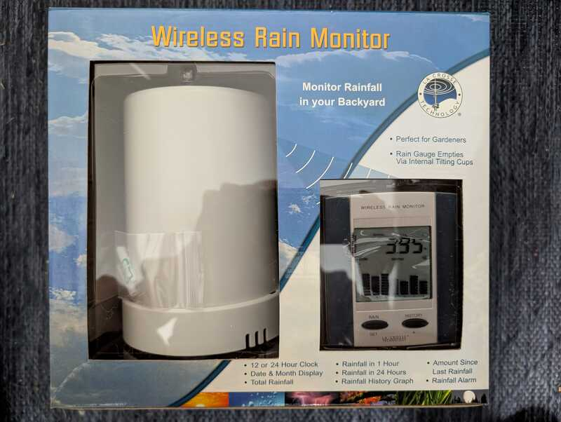

# LaCrosse TX5U rain gauge 433 MHz

Tipping bucket rain sensor for the La Crosse Technology WS-7038U Wireless Rain
Monitor (also sold with the WS-7058U Wireless Forecast Station). Retired product.

## Device Info

* WS-7058U product page (lists the TX5U rain sensor, 433 MHz, 0.0105"/tip):
  https://www.lacrossetechnology.com/products/ws-7058u
* WS-7038U manual: https://www.manualslib.com/manual/516329/La-Crosse-Technology-Ws-7038u.html
* TX5U manual: https://www.manualslib.com/manual/91038/La-Crosse-Technology-Tx5u.html

## Protocol

Same OOK PWM protocol and 44 bit message as the TX6U/TX7U (`lacrosse.c`),
with message type `0xA`:

    0 A T II IP V V V R R C

- T: type, `A` = rain
- II IP: 7 bit id and parity bit (even parity over the value bits)
- VVV: 12 bit binary tip counter (not BCD, e.g. `00e`, `00f`, `010`)
- RR: repeat of the upper 8 bits of the counter
- C: sum of nybbles 0-9, low 4 bits

One tip is 0.0105 in (0.2667 mm). Pulses are ~504 us (1) and ~1212 us (0),
with ~888 us gaps; each message is sent twice, ~117 ms apart.

A message is sent immediately on each tip, then repeated about every 8.4 s for
a few minutes, then about every 51 s (the manual says "every minute if no rain").

Flex decoder:

    -X 'n=tx5u,m=OOK_PWM,s=504,l=1212,r=8000,g=3000,bits=44'

## Files

Recorded with `-S unknown`, trimmed to about 50 ms around the messages.
The counter was advanced by tipping the bucket by hand.

* `count14_433.92M_250k.cu8`: id 4, 14 tips (`{44}0aa0900e00b`, parity 1)
* `count15_433.92M_250k.cu8`: id 4, 15 tips (`{44}0aa0800f00b`, parity 0)
* `tips18to21_433.92M_250k.cu8`: four tips in a row, 18 to 21,
  one message pair per tip ~0.5 s apart
* `count25_433.92M_250k.cu8`: id 4, 25 tips (`{44}0aa09019018`)

Other received codes:

    {44}0aa0901001f  16 tips
    {44}0aa0801101f  17 tips
    {44}0aa08012010  18 tips
