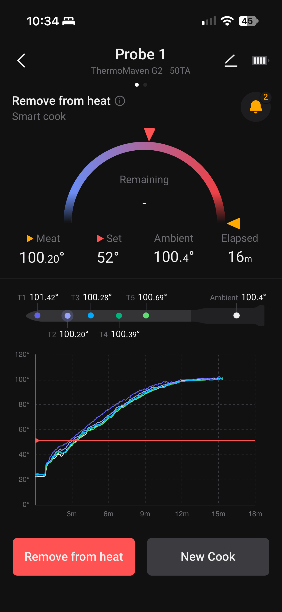
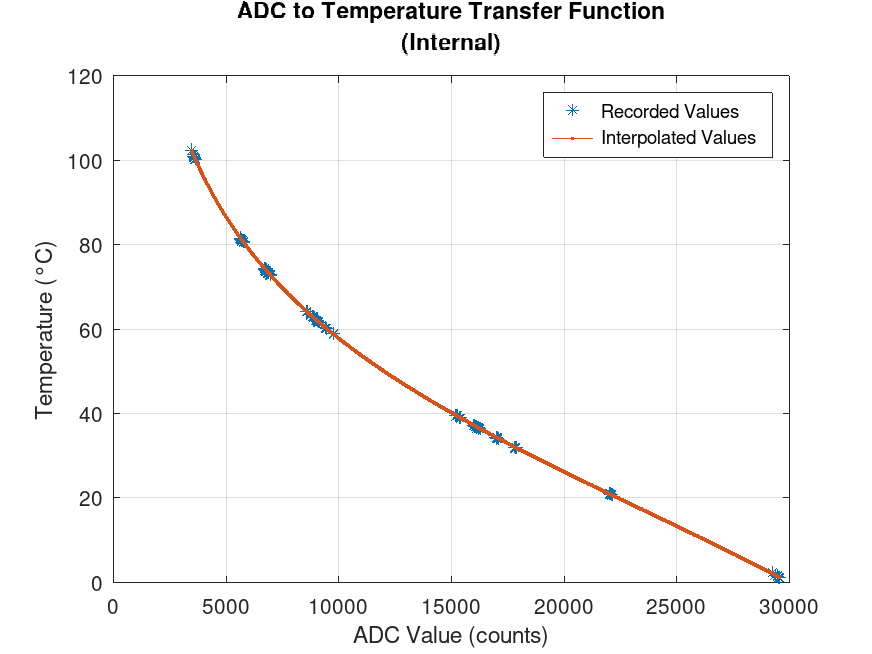
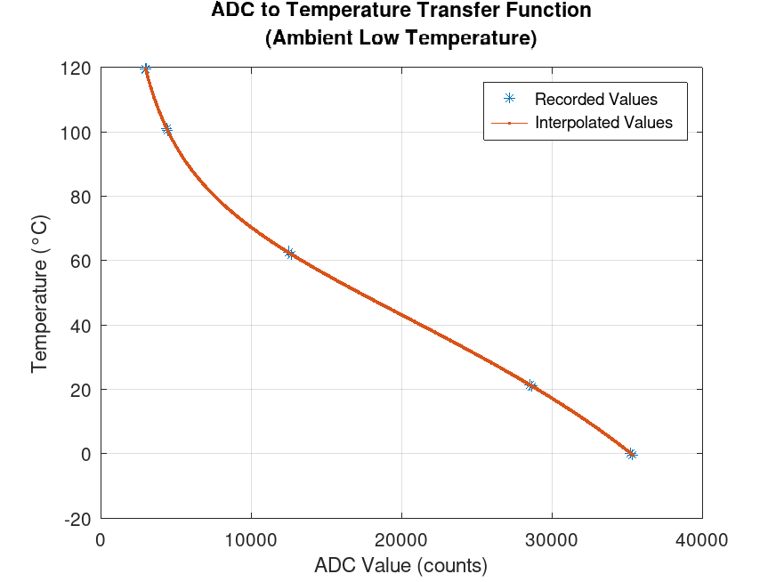
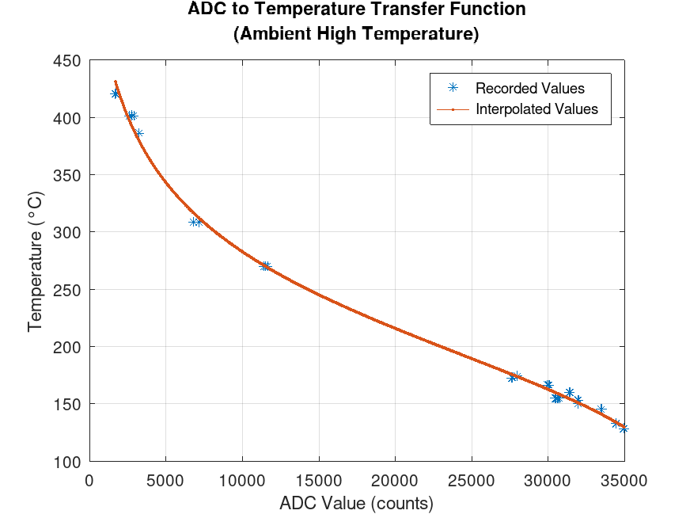

# ThermoMaven WTP Meat Thermometer Probe

## Overview

[ThermoMaven Sub-1G Probes](https://www.thermomaven.com/products/g2) are bundled with base
stations, with high level product models (i.e. G1, G2) that obscure the model number of the
probes (i.e WTP4000, WTP5000) that are not sold separately. WTP4000 and WTP5000 probes operate
at 915 and 916 MHz, respectively, but otherwise appear to function identically.

## Product Details

Each probe has 5 internal temperature sensors with a temperature range specification of
0 to 105 degrees C and an accuracy of +/- 0.3 degrees C. Additionally, each probe has
an ambient temperature sensor with a -10 to 400 degree C range, but no associated
accuracy specification. Thermomaven covers the wider dynamic range of the ambient sensor
with two gain stages covering above and below ~120 degrees C. The following image shows
how these sensor values are presented to the use on the apps that interface with base
stations, that in turn interface with sub-1G probes:



## Analog to Digital Converter (ADC) to Temperature Transfer Functions

[Steinhard-Hart equations](https://en.wikipedia.org/wiki/Steinhart%E2%80%93Hart_equation)
equations provide a good emperical fit to the application observed temperatures,
where each figure below plots specific observed radio ADC values and application
temperature pairs as an asterisk and the Steinhard-Hard interpolated values as a
continuous line. This work can be reproduced by executing the adjacent `wtp.m`
script within the [GNU Octave](https://octave.org/) program.

### Internal Temperature Transfer Function



### Ambient Low Range Transfer Function



### Ambient High Range Transfer Function



### Resulting Coefficients

```
MEAT (Ch 1-5)  | D_max = 42784.11 | RMSE = 0.1045 C | A=3.38191203e-03, B=3.15996392e-04, C= 1.28546405e-05, D= 1.88934100e-06
AMB  (Ch 6/Lo) | D_max = 50257.07 | RMSE = 0.1342 C | A=3.29390756e-03, B=3.48641617e-04, C= 7.82776569e-05, D= 1.80483142e-05
AMB  (Ch 6/Hi) | D_max = 38194.51 | RMSE = 4.5116 C | A=2.02454117e-03, B=2.17752569e-04, C=-3.11401505e-06, D=-3.26078685e-06
```

## References
* [FCC Filings](https://fcc.report/company/Typhur-Inc)
* [Internal Probe Photo](https://fccid.io/2BEFM-WTP4000/Internal-Photos/Internal-Photos-8235048)
* [Texas Instruments (TI) MSPM0C1104S Datasheet](https://www.ti.com/lit/ds/symlink/mspm0c1104.pdf)
* [Huahui Energy HTC4016 2.4V Battery](https://www.huahuibattery.com/htc4016-lto-battery-for-meat-probe-and-stylus.html)
