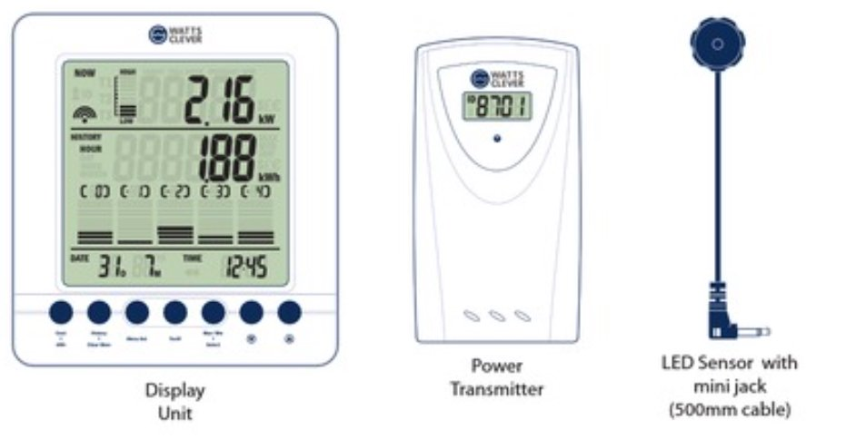

# Watts Clever EW4500 (Hideki WAC22) Optical Energy Meter Reader

433.92 MHz (measured ~433.85 MHz) optical pulse reader for electricity meters
with flashing LED pulse outputs. Direct protocol sibling of the Norgo NGE101
(`norgo.c`), adding a 16-bit BCD transmitter ID and a nibble-stream whitening
layer keyed by the XOR checksum byte.

## Signal Summary

- **Modulation:** Inverted OOK Differential Manchester Coding (`OOK_PULSE_DMC`),
  `short_width = 488 us`, `long_width = 976 us`, `reset_limit = 2500 us`
  (32.768 kHz crystal).
- **Framing:** 8-bit sync byte `0xFA` (after `bitbuffer_invert()`) followed by
  a 56-bit (7-byte) or 72-bit (9-byte) payload protected by CRC-8
  (`poly = 0x07`, `init = 0x00`).
- **Cadence:** Alternating 2-frame bursts every `31 - 2 * channel` seconds
  (29 s on CH 1, 21 s on CH 5):
  - **Burst A:** 72-bit cumulative `impulses` + `battery_ok` frame followed
    ~178 ms later by a 56-bit instantaneous `gap` frame.
  - **Burst B:** Two identical 56-bit `gap` frames ~163 ms apart (deduplicated
    to a single output record by the decoder).

## Samples

- `burst_a_433.92M_1000k.cu8` — Burst A capture (`id = 1063`, `channel = 1`,
  `impulses = 52602468`, `battery_ok = 1`, `gap = 0`, 1000k sample rate).
- `burst_b_433.92M_1000k.cu8` — Burst B capture (`id = 1063`, `channel = 1`,
  `gap = 0`, verifying deduplication of the repeated 56-bit frame).
- `low_battery_1kw_433.92M_250k.cu8` — Burst A capture at 2.40 V low battery
  and ~1.000 kW load (`id = 5999`, `channel = 1`, `impulses = 52647761`,
  `battery_ok = 0`, `gap = 3687`, 250k sample rate).
- `ch3_3600w_433.92M_250k.cu8` — Burst A capture on channel 3 at 3.00 V and
  3.600 kW load (`id = 5999`, `channel = 3`, `impulses = 52647826`,
  `battery_ok = 1`, `gap = 1024`, 250k sample rate).
- `codes_test.txt` / `codes_test.json` — Verified Burst B bitbuffer pairs
  covering 14 calibrated power steps from 0 W (`gap = 0`) to 69.55 kW
  (`gap = 53`), additional transmitter IDs (`7844`, `5784`), idle `Packet B`
  rejection, and CRC-8 rejection.

## Converting `gap` and `impulses` to kW and kWh

Because meter pulse constants (`imp_per_kwh`) vary by electricity meter
(commonly `1000`, `800`, `1600`, or `3200 imp/kWh`), the decoder reports the
native `gap` (in `1/1024 s` ticks) and `impulses` counts:

- `power_kW = 3686400.0 / (imp_per_kwh * gap)` (`0` when `gap == 0`)
- `energy_kWh = impulses / imp_per_kwh`

For a `1000 imp/kWh` meter:
- `power_kW = 3686.4 / gap` (e.g. `gap = 1024` -> `3.600 kW`, `gap = 2048` -> `1.800 kW`)
- `energy_kWh = impulses / 1000.0` (e.g. `impulses = 52602468` -> `52602.468 kWh`)

## Additional Reference Bitbuffer Codes (Burst A)

These 2-frame Burst A codes emit two JSON lines each (`impulses`/`battery_ok`
and `gap`) and can be replayed with `rtl_433 -c 0 -F json -y "<code>"`:

- Channels 1–5 (`id = 1063`, `impulses = 52593700`, `battery_ok = 1`, `gap = 0`):
  - CH 1: `{80}0541279fa69b073f8b47 {64}059f7c31cda3d3ee`
  - CH 2: `{80}056fb4958f83e89ace3d {64}05fe686e421d9610`
  - CH 3: `{80}054bda2b0974341fae95 {64}059e8bda32b3f68e`
  - CH 4: `{80}0526949a5b96d4c2ebd4 {64}05d68b07e314b36f`
  - CH 5: `{80}054fe9f0dad6bdcd9bcf {64}059bffb7f06ac36e`
- Battery voltage threshold (`id = 7844`, `channel = 1`, `impulses = 52567135`):
  - 2.43 V (`battery_ok = 0`): `{80}057b8c4196a905bdb082 {64}05b558c0910c90fd`
  - 3.00 V (`battery_ok = 1`): `{80}0506455bf8815768b23e {64}05b558c0910c90fd`
- Additional transmitter IDs (`channel = 1`, `battery_ok = 1`, `gap = 0`):
  - `id = 1096` (`impulses = 52567135`): `{80}0564dc68157e77a1030b {64}05e9da3a3ba12700`
  - `id = 5784` (`impulses = 52593700`): `{80}050642cbe2df415bfa6e {64}05ed1bffc6acadd6`
  - `id = 9367` (`impulses = 52593700`): `{80}056d472df682f5e5818d {64}05a7759d5bd4d943`
